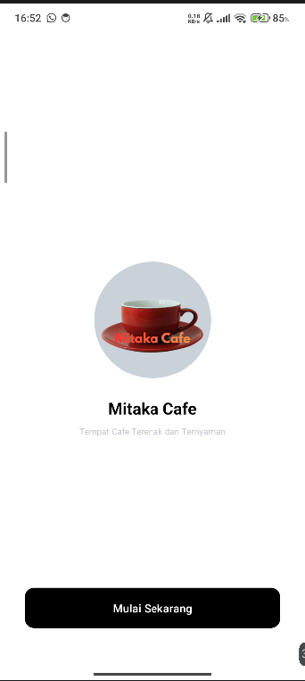
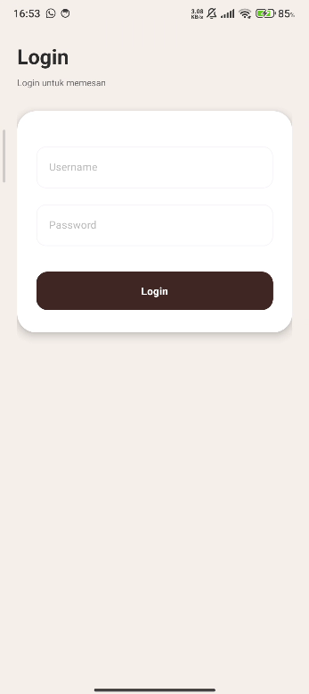
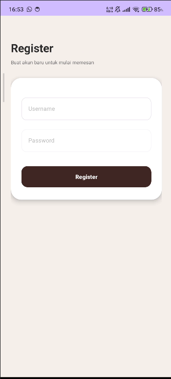
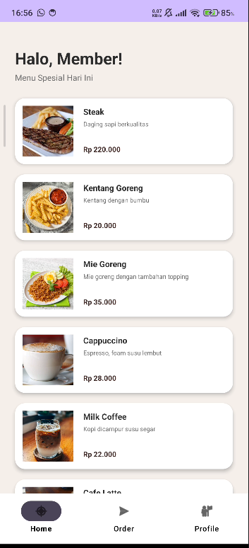
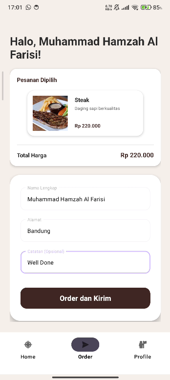
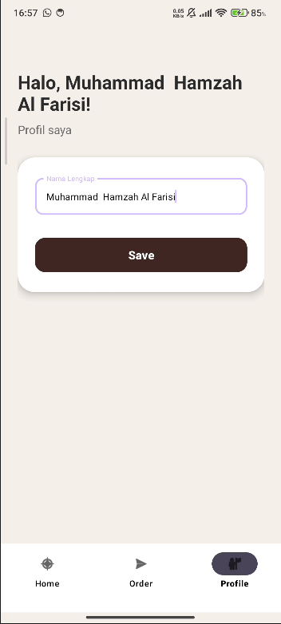
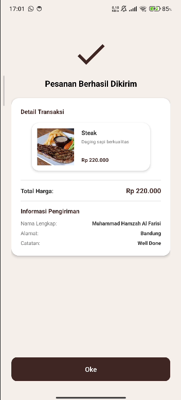

# ☕ Mitaka Cafe (Kopi dan Nyemil) - Android App

Aplikasi **Mitaka Cafe (Kopi dan Nyemil)** adalah purwarupa (prototype) aplikasi pemesanan makanan dan minuman berbasis Android. Aplikasi ini dirancang dengan antarmuka pengguna (UI) yang modern, hangat, dan minimalis ala kafe kekinian.

Proyek ini dibuat untuk mendemonstrasikan implementasi *User Interface* (UI) dan navigasi di Android Studio menggunakan XML dan Kotlin, tanpa menggunakan integrasi *database* (menggunakan *dummy data* statis).

## ✨ Fitur Utama

Aplikasi ini mencakup beberapa alur layar utama:
1. **Splash Screen & Welcome**: Layar pembuka dengan logo kafe.
2. **Autentikasi (UI)**: Halaman *Sign Up*, *Login*, dan *Register* dengan desain form yang rapi menggunakan `TextInputLayout`.
3. **Katalog Menu (Home)**: Menampilkan daftar menu makanan dan minuman spesial hari ini menggunakan `RecyclerView`.
4. **Pemesanan (Order)**: Halaman untuk mengisi alamat pengiriman dan ringkasan pesanan.
5. **Konfirmasi Pesanan**: Halaman notifikasi ketika pesanan berhasil dibuat.
6. **Profil Pengguna**: Halaman untuk melihat dan mengubah nama pengguna.
7. **Bottom Navigation**: Navigasi bawah yang mulus untuk berpindah antara halaman Home, Order, dan Profile.

## 🔄 Alur Aplikasi (App Flow)

Berikut adalah skenario penggunaan aplikasi dari awal hingga selesai melakukan pemesanan:

1. **Membuka Aplikasi:** Saat pertama kali dibuka, pengguna akan melihat layar *Splash / Welcome* dengan logo kafe. Menekan tombol "Mulai" akan membawa pengguna ke halaman *Sign Up*.
2. **Autentikasi:** Di halaman *Sign Up*, pengguna memilih untuk "Register" (buat akun baru) atau "Login" (masuk ke akun yang sudah ada).
    * Jika memilih **Register**, pengguna diarahkan ke form pendaftaran untuk mengisi nama lengkap, username, dan password.
    * Setelah mendaftar atau jika sudah memiliki akun, pengguna diarahkan ke form **Login**. Memasukkan username dan password akan membawa pengguna masuk ke aplikasi utama.
3. **Eksplorasi Menu:** Pengguna akan masuk ke halaman **Home**, yang menampilkan sapaan "Halo, Member!" dan daftar menu (*dummy data* statis) seperti Kopi Susu Gula Aren, Donat Cokelat, dll.
4. **Checkout & Pengiriman:** Pengguna dapat berpindah ke tab **Order** melalui menu navigasi bawah (*Bottom Navigation*). Di halaman ini, pengguna dapat melihat ringkasan pesanan dan mengisi formulir pengiriman (Nama, Alamat, Catatan).
5. **Konfirmasi:** Setelah menekan tombol "Order dan Kirim", layar **Konfirmasi Pesanan** akan muncul sebagai pemberitahuan bahwa pesanan sedang diproses. Pengguna kemudian dapat menekan "Oke" untuk kembali ke menu utama.
6. **Pengaturan Akun:** Melalui tab **Profile** di navigasi bawah, pengguna dapat melihat dan memperbarui nama profil mereka.

## 📱 Screenshot Tampilan

| Splash / Welcome | Sign Up | Login | Register |
| :---: | :---: | :---: | :---: |
|  |  |  |  |

| Home (Menu) | Order (Checkout) | Profile | Konfirmasi |
| :---: | :---: | :---: | :---: |
|  |  |  |  |

## 🛠️ Teknologi yang Digunakan

* **Bahasa Pemrograman**: [Kotlin](https://kotlinlang.org/)
* **Desain Antarmuka (UI)**: XML
* **IDE**: Android Studio
* **Komponen Utama**: 
  * `ConstraintLayout` (Tata letak responsif)
  * `RecyclerView` (Daftar menu dinamis)
  * `CardView` (Desain kartu menu dan form)
  * `BottomNavigationView` (Navigasi utama)
  * Material Design Components (`TextInputLayout`, `TextInputEditText`)

## 🚀 Cara Menjalankan Aplikasi Secara Lokal

Ikuti langkah-langkah berikut untuk menjalankan aplikasi ini di komputer Anda:
1. *Clone* repositori ini: `git clone https://github.com/Malkistt/Mitaka_Cafe.git`
2. Buka proyek menggunakan **Android Studio**.
3. Tunggu hingga proses sinkronisasi Gradle selesai.
4. Jalankan aplikasi di Emulator atau perangkat fisik Android Anda dengan menekan tombol **Run** (Shift + F10).
